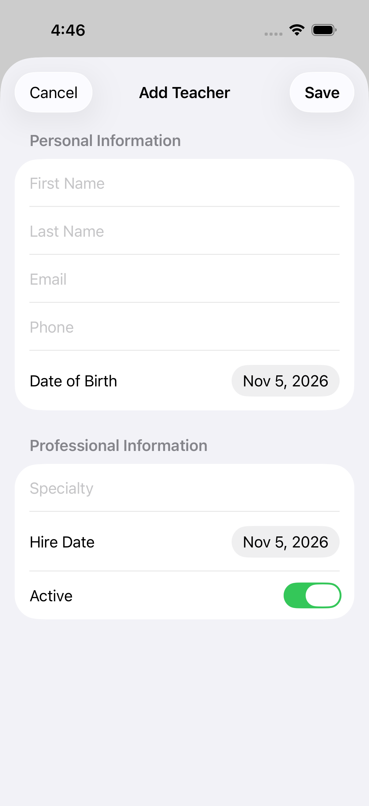
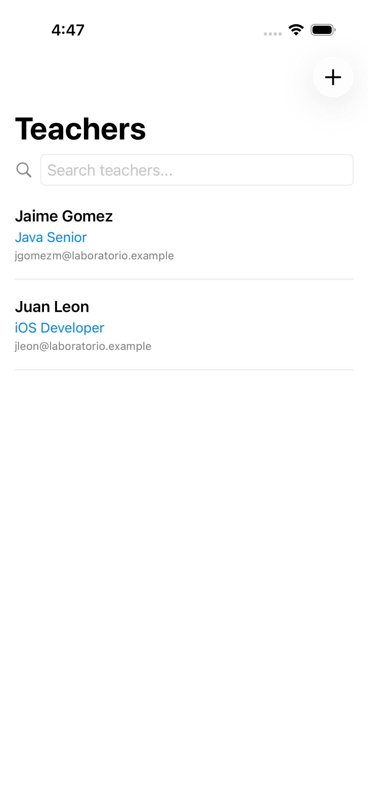
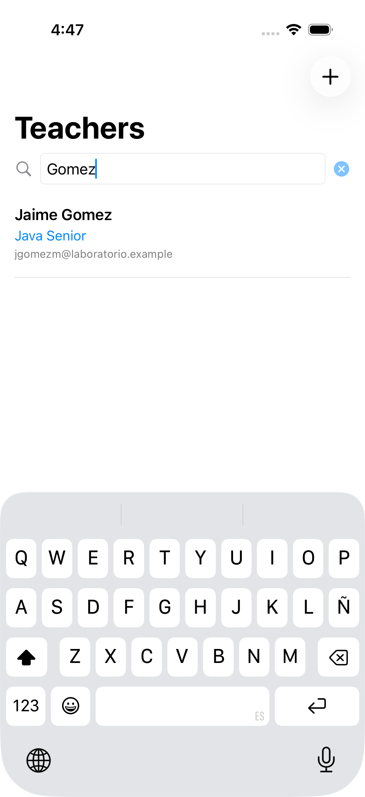
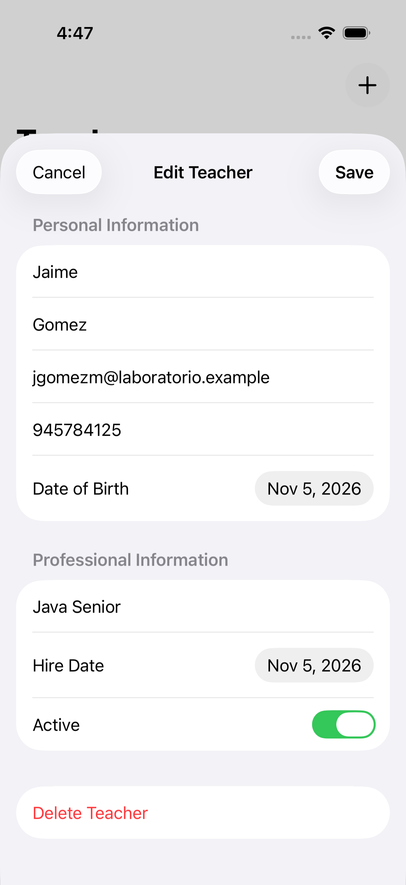
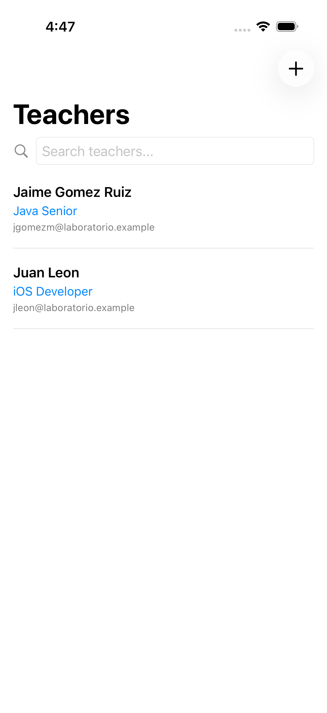
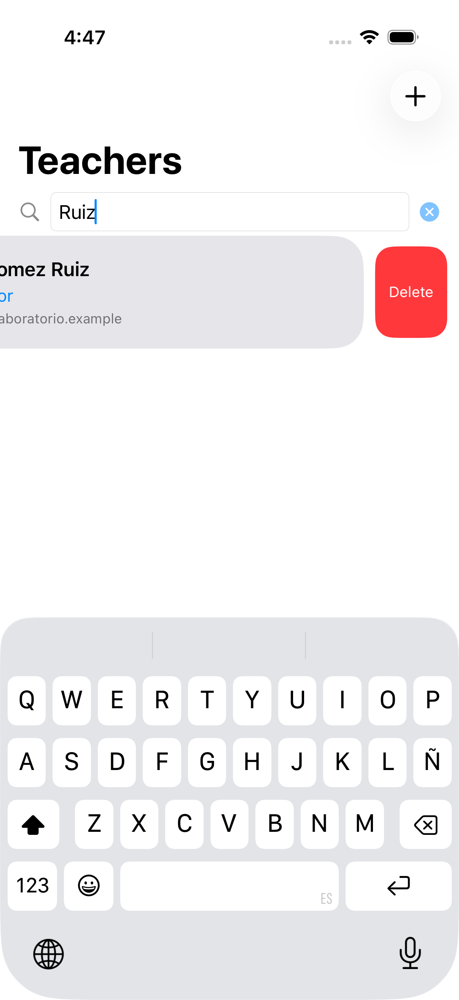
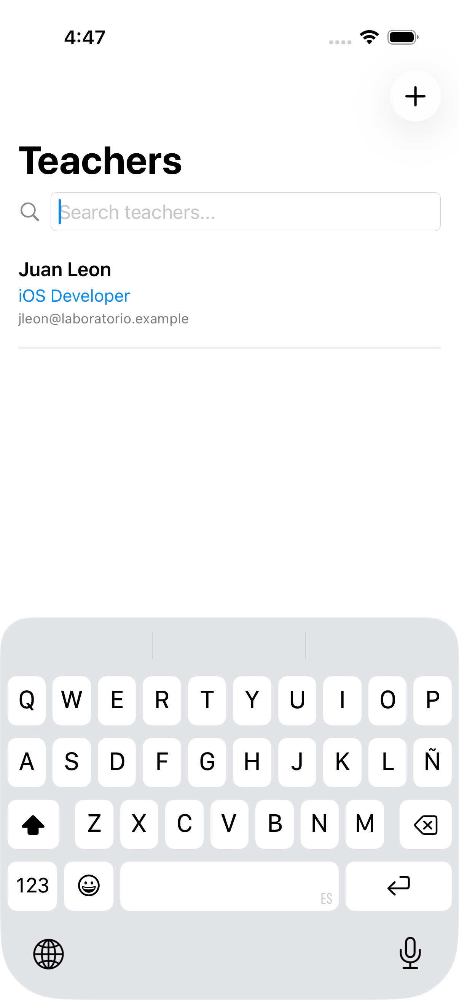

# Práctica Calificada 03 — CRUD de Docentes con SwiftData

**Estudiante:** Anthony Fernando Arana Apaza

La aplicación permite registrar, consultar, actualizar y eliminar docentes desde un iPhone. Cada ficha reúne el nombre, el apellido, el correo electrónico, el teléfono y la fecha de nacimiento del docente, junto con su especialidad, fecha de contratación y estado activo. Los registros se almacenan en el dispositivo y se conservan al cerrar y volver a abrir la aplicación.

## Tecnologías empleadas

La aplicación se desarrolló en **Swift**. Se utilizó **SwiftUI** para la navegación, los formularios y la lista de docentes. Con **SwiftData** se definió el modelo `Docente`, se configuró el almacenamiento local y se vinculó la lista a los registros guardados mediante `@Query`. La compilación se realizó con **Xcode 26.6** y las operaciones se verificaron con **XCUITest** en un simulador de iPhone 17 Pro con iOS 26.5.

## Funcionalidades implementadas

| Actividad | Comportamiento |
| --- | --- |
| Pantalla principal | La vista *Teachers* reúne el buscador, la lista y el botón **+** para abrir el formulario. |
| Registro | El formulario *Add Teacher* valida los campos obligatorios, el formato del correo, el teléfono y la coherencia entre las fechas. El correo es único por docente. |
| Listado | Cada fila muestra el nombre completo, la especialidad y el correo. Los registros se ordenan por nombre y apellido. |
| Búsqueda | La lista se filtra al escribir un nombre, apellido, especialidad o correo. Al limpiar la búsqueda, se recupera la lista completa. |
| Edición | Al seleccionar una fila se abre *Edit Teacher*. **Save** actualiza el mismo registro y **Cancel** descarta los cambios. |
| Eliminación | Un docente puede eliminarse al deslizar su fila hacia la izquierda o mediante **Delete Teacher** en su ficha. |

## Capturas de la aplicación

Las siguientes capturas corresponden a la aplicación ejecutada en el simulador. La secuencia muestra el registro de dos docentes, la búsqueda de uno de ellos y el resultado de editarlo y eliminarlo.

| Pantalla principal | Formulario de registro |
| :---: | :---: |
|  |  |
| **Docentes registrados** | **Búsqueda por apellido** |
|  |  |
| **Ficha de edición** | **Edición guardada** |
|  |  |
| **Eliminación por deslizamiento** | **Lista después de la eliminación** |
|  |  |

## Resultados de compilación y pruebas

La aplicación compiló con Xcode 26.6 para iPhone 17 Pro con iOS 26.5. [Captura de compilación](evidencias/09-compilacion.png)

En la verificación de esta implementación se aprobaron dos pruebas de interfaz con XCUITest:

| Prueba | Resultado observado |
| --- | --- |
| CRUD y persistencia | Se registraron dos docentes, se filtró la lista por apellido y se editó un registro sin duplicarlo. Se comprobó la cancelación de cambios y la eliminación desde la ficha y por deslizamiento. Al volver a abrir la aplicación se conservaron los cambios. |
| Validación y correo único | Se rechazaron un correo inválido, un teléfono incompleto y un correo duplicado escrito con mayúsculas. El cambio del estado activo persistió tras relanzar la aplicación. |

## Ejecución en Xcode

1. En una Mac con Xcode y un simulador de iOS **18.2 o posterior**, clonar el repositorio y abrir el proyecto:

   ```sh
   git clone https://github.com/anthonyarana-debug/Practica-Calificada-03-SwiftData-Final.git
   cd Practica-Calificada-03-SwiftData-Final
   open apple_lab12_pract03_SwiftData.xcodeproj
   ```

2. En Xcode, seleccionar el esquema `apple_lab12_pract03_SwiftData` y un iPhone como destino de ejecución. Para reproducir el entorno de verificación, seleccionar **iPhone 17 Pro con iOS 26.5**.
3. Pulsar **⌘R** para compilar y ejecutar. En la pantalla *Teachers*, pulsar **+** para registrar el primer docente.

## Procedencia y créditos

El proyecto base, el enunciado y las seis pantallas de referencia de la carpeta [images](images/) proceden del [repositorio original del docente, Jaime Gomez](https://github.com/jgomezz/apple_lab12_pract03_SwiftData). A partir de ese material, Anthony Fernando Arana Apaza desarrolló el CRUD de docentes con SwiftData. Las capturas de [evidencias](evidencias/) corresponden a esta implementación.
